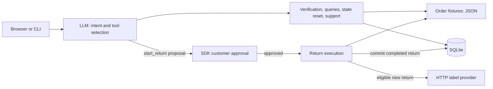

# Ciderlane Return Agent

A customer-support agent for a fictional fashion retailer, built with Python, the
OpenAI Agents SDK, FastAPI, and SQLite. Customers can check return eligibility,
approve a return, retrieve an existing label, or request human review.

The project explores a practical agent engineering problem: combining flexible
conversation with trusted business facts, explicit approval, and recoverable
external side effects. It includes a browser demo, a CLI, deterministic tests,
and multi-turn agent evaluations based on manual testing failures.

## Capabilities

- Verify an order using its ID and checkout email before accessing order details.
- Resolve the requested item, including ambiguous names and conflicting descriptions.
- Apply return-window, final-sale, and swimwear policies through Python tools.
- Pause return creation for customer approval, then recheck stored facts at execution time.
- Reuse completed returns and labels instead of creating duplicates.
- Create persistent support cases for authorized verification failures, disputes,
  and restricted-item exceptions.
- Handle renewed requests after rejection and invalidate verification when switching orders.

## Architecture



The model supplies an item ID and canonical reason; the application owns the
verified order, stored policy facts, and current evaluation. Business tools reject
unverified or mismatched items. `start_return` requires SDK approval and evaluates
fresh facts independently of earlier eligibility answers.

A confirmed order switch uses `begin_new_order_request` to clear verification and
policy evidence while preserving conversation identity and persisted records.
Tool calls are sequential. Intent, clarification, and dialogue order remain
model-driven and are measured with evals; there is no separate request controller.

## Quick start

These commands assume a macOS or Linux shell, Python 3.11, and SQLite 3.35 or newer.
Run them from the repository root.

### 1. Install dependencies

```bash
python3.11 -m venv .venv
.venv/bin/python -m pip install -r requirements.txt
```

Create a local `.env` file, which is excluded from Git:

```dotenv
OPENAI_API_KEY=your_openai_api_key
```

The current agent uses `gpt-5.6-luna`; live evals also use `gpt-5.6-sol` as a response
grader. The API account must have access to these configured models.

### 2. Start the mock label provider

In one terminal:

```bash
.venv/bin/python -m evals.mock_label_provider
```

It serves `http://127.0.0.1:8765/labels` with token `mock-token`. It returns stable,
fake label URLs and creates no real shipping labels.

### 3. Start the browser demo

In another terminal:

```bash
CIDERLANE_DATABASE_PATH="$(mktemp -d)/ciderlane-demo.db" \
CIDERLANE_LABEL_PROVIDER_URL=http://127.0.0.1:8765/labels \
CIDERLANE_LABEL_PROVIDER_TOKEN=mock-token \
CIDERLANE_REFERENCE_DATE=2026-08-31 \
.venv/bin/python -m uvicorn src.api:app --host 127.0.0.1 --port 8000 --workers 1
```

Open [the local demo](http://127.0.0.1:8000/) and enter:

> Please return the white short dress from order CL1002. My email is maya@example.com.

Review the proposed item and click **Approve** or **Reject**. Approval alone does
not guarantee a return: the tool checks current policy before requesting a label.

The fixed reference date keeps the bundled August order within its return window.
Each execution of this command uses a new temporary database. To retain business
records across server restarts, replace the database value with a stable path such
as `data/demo.db`. Refreshing the page starts a new conversation but preserves
records in the running server's database. Restart the server after code changes.

For the CLI, keep the mock provider running and use the same settings:

```bash
CIDERLANE_DATABASE_PATH="$(mktemp -d)/ciderlane-demo.db" \
CIDERLANE_LABEL_PROVIDER_URL=http://127.0.0.1:8765/labels \
CIDERLANE_LABEL_PROVIDER_TOKEN=mock-token \
CIDERLANE_REFERENCE_DATE=2026-08-31 \
.venv/bin/python -m src.main
```

## Demo scenarios

The bundled orders use `maya@example.com`. With the reference date above:

| Input | Expected behavior |
| --- | --- |
| `Can I return the white short dress from order CL1002? My email is maya@example.com.` | Check eligibility without return approval or label creation. |
| `Please return the white short dress from order CL1002. My email is maya@example.com.` | Propose the item for approval; create a return and label only after approval and a successful provider response. |
| After Reject: `Sorry, actually return it.` | Offer fresh approval for the renewed request. |
| After creation: `Can I still return the white short dress?` | Report the existing return and original label. |
| `Can I return the black pants from order CL1002? My email is maya@example.com.` | Explain the final-sale restriction. |
| `Can I return the pink swimsuit from order CL1002? It arrived damaged. My email is maya@example.com.` | Create a support case for human review; do not create a return label. |
| `Can I return the floral long dress from order CL1001? My email is maya@example.com.` | Explain that the 30-day window has expired. |

## Return policy

Policies are implemented in [return_tools.py](src/tools/return_tools.py), with the
return window evaluated first:

| Condition | Decision |
| --- | --- |
| More than 30 days since delivery | `blocked` |
| Within 30 days, non-final-sale, non-swimwear | `standard_return` |
| Within 30 days, final-sale or swimwear, without a damaged/wrong-item reason | `blocked` |
| Within 30 days, restricted item reported damaged or wrong | `exception_flow`: human review |

A blocked result alone does not create a support case. Separate escalation rules
cover a supported final-sale dispute, continued anger after a policy explanation,
and unavailable or repeatedly failing verification. Human review does not imply
return approval. The unworn, unwashed, and tags-attached requirements are
communicated to customers; the demo cannot inspect an item's physical condition.

## Reliability and persistence

SQLite stores completed returns, pending label-request keys, and support cases.
Returns are unique by `(order_id, item_id)`. Both eligibility queries and return
execution retrieve a completed return before calculating new policy results.
Eligibility queries do not create database files, initialize tables, or call the
label provider.

For a new eligible return, the application commits an idempotency key before
calling the provider. Timeouts, connection failures, and HTTP 5xx responses retry
with that same key using bounded exponential waits. A valid provider response is
followed by a transaction that saves the completed return and removes its pending
request. Failures retain the key for a later approved retry. HTTP runs outside
SQLite transactions; the provider must honor the idempotency key.

See [tool contracts](docs/tools.md) and [engineering decisions](docs/engineering-notes.md)
for authorization, failure codes, and recovery behavior.

## Tests and evaluations

### Unit tests

```bash
OPENAI_AGENTS_DISABLE_TRACING=1 .venv/bin/python -m unittest discover -s tests
```

Unit tests use scripted models, temporary databases, and mocked or local HTTP
providers. They require no OpenAI API key or real label service. GitHub Actions
runs them for pushes to `main`, pull requests targeting `main`, and manual runs.

### Live agent evals

```bash
OPENAI_AGENTS_DISABLE_TRACING=1 .venv/bin/python -m evals.run_evals \
  --output /tmp/ciderlane-evals.json
```

This starts its own mock HTTP provider on an available port and uses an isolated
database per case. It calls the configured OpenAI models and incurs API usage;
you do not need to start uvicorn or the separate mock server.

The 30 cases cover business outcomes and multi-turn behavior. The runner exercises
the browser's backend session and approval handlers, records tool calls and
database changes, and combines deterministic checks with a separate response
grader. Scripted turns declare their approval decisions; unexpected approvals
fail and are never executed. Browser rendering is checked separately by hand.

Run selected cases by repeating `--case`:

```bash
OPENAI_AGENTS_DISABLE_TRACING=1 .venv/bin/python -m evals.run_evals \
  --case rejected_return_then_pronoun_retry \
  --case different_invalid_order_verifies_before_item_selection \
  --output /tmp/ciderlane-regressions.json
```

To test a provider configured through the environment or `.env`, add
`--use-configured-provider`. Live evals are run manually; CI runs unit tests.

Recorded validation on **2026-10-08**:

| Check | Result |
| --- | --- |
| Unit tests | 169 / 169 |
| Full live agent suite | 30 / 30, one full run |
| Two focused regressions, three runs each | 6 / 6 |

These results describe the recorded implementation and test inputs. See the
[validation notes](docs/engineering-notes.md#recorded-validation) for scope.

## Configuration

The CLI, HTTP service, and eval runner load `.env`. Process environment values
take precedence.

| Variable | Purpose / default |
| --- | --- |
| `OPENAI_API_KEY` | Required for live agent and response-grader calls. |
| `CIDERLANE_DATABASE_PATH` | SQLite path; defaults to `data/ciderlane.db`. |
| `CIDERLANE_REFERENCE_DATE` | Optional ISO date (`YYYY-MM-DD`); defaults to the current local date. |
| `CIDERLANE_LABEL_PROVIDER_URL` | Required to create a new label; absolute HTTP(S) endpoint. |
| `CIDERLANE_LABEL_PROVIDER_TOKEN` | Provider bearer token. |
| `CIDERLANE_LABEL_TIMEOUT_SECONDS` | Positive finite timeout per attempt; default `5`. |
| `CIDERLANE_LABEL_MAX_ATTEMPTS` | Total attempts, including the first; `1`–`5`, default `3`. |

The provider accepts a POST containing `order_id` and `item_id`, with bearer
authorization and an `Idempotency-Key` header. Success requires a 2xx JSON response
with a valid absolute HTTP(S) `label_url`. Redirects are not followed.

## HTTP API

| Endpoint | Purpose |
| --- | --- |
| `GET /` | Browser chat and approval UI. |
| `POST /sessions` | Create a server-generated session ID. |
| `POST /sessions/{session_id}/chat` | Send `{"message":"..."}`; receive `completed` or `approval_required`. |
| `POST /sessions/{session_id}/approval` | Send `{"approval_id":"...","decision":"approve"}` or `reject`; resume the stored SDK state. |

Clients supply no verification state, policy facts, or tool arguments. Pending
approval blocks additional chat. Stale or consumed approvals return HTTP 409;
unknown sessions return HTTP 404. Each session serializes its requests with a lock.

## Project map

| Path | Responsibility |
| --- | --- |
| `src/agent.py` | Agent instructions, model, and tool registration. |
| `src/agent_tools.py` | Model-visible tool schemas and context updates. |
| `src/context.py` | Verified order, conversation identity, and immutable policy evaluation. |
| `src/tools/` | Order lookup, deterministic policy, return execution, and support authorization. |
| `src/storage.py` | SQLite schema, read-only return lookup, and durable key reservation. |
| `src/return_label_provider.py` | Validated HTTP label integration and retries. |
| `src/api.py`, `src/main.py`, `src/static/` | HTTP sessions, CLI approval flow, and browser UI. |
| `evals/` | Scenario fixtures, multi-turn runner, mock provider, and historical manual reports. |
| `tests/` | Deterministic tests of tools, persistence, API approvals, provider recovery, and eval infrastructure. |

## Scope

This is a local demonstration with synthetic order data. Order ID/email matching
illustrates verification; the HTTP demo has no production authentication. Sessions,
conversation history, and pending approvals live in one process, so the service
requires one worker and loses those states on restart. SQLite business records
survive when the same database path is reused.

Cancellation stops an uncreated request in conversation; it does not cancel an
already-created shipment or issue a refund. Support cases are local records, with
no external ticketing integration. Dialogue decisions and semantic grading remain
model-dependent. The project does not claim production deployment or exhaustive
coverage of future conversations.

## Further reading

- [Agent boundary](docs/agent-boundary.md): responsibilities and enforcement layers.
- [Return workflow](docs/return-workflow.md): verification, selection, approval, and escalation.
- [Tool contracts](docs/tools.md): inputs, results, and failure behavior.
- [Engineering notes](docs/engineering-notes.md): design decisions, regression strategy, and recorded results.
