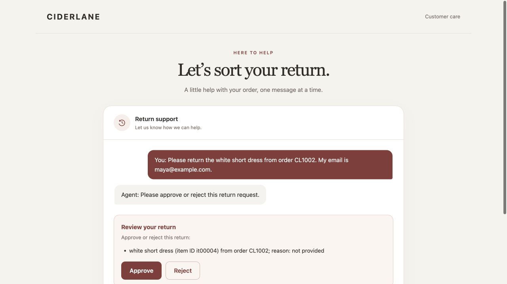
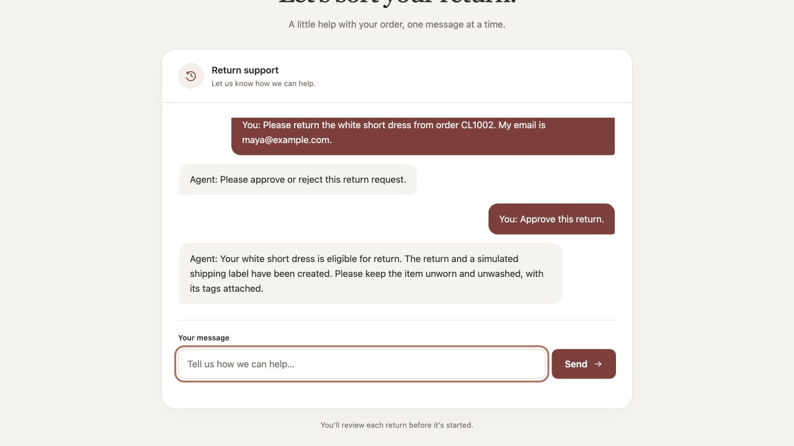

# A return, from request to approval

This walkthrough uses the application's browser UI, the real Agents SDK, actual return tools, a disposable SQLite database, and the mock HTTP label provider. A scripted model supplies tool calls and final wording for repeatable screenshots. It makes no paid model calls and is not evidence of live-model conversation quality. Live evaluation results are documented separately in [engineering notes](engineering-notes.md#recorded-validation).

## 1. Request a return

The fictional customer asks:

> Please return the white short dress from order CL1002. My email is maya@example.com.

Order fixtures verify the order and email. The application resolves the white short dress as `it00004`. The fixed reference date, `2026-08-31`, keeps this fixture within its return window.

## 2. Review the proposed action

The SDK pauses `start_return`. The interface describes the item from verified application state and offers **Approve** and **Reject**. While approval is pending, the chat composer is disabled. No return or label has been created at this point.

## 3. Approve and inspect the result

Approval consumes the pending approval ID and resumes the SDK. The tool reloads current policy facts, reserves a durable idempotency key, and calls the local mock label provider. A completed return is stored once per order/item. The screenshot's final reply is scripted; the approval, provider request, and database write are real local operations.

The provider produces a fake label URL under `mock-labels.example.test`. It does not purchase shipping or generate a usable shipping label. Screenshots contain only fictional repository fixtures.

## What rejection and retries do

| Customer action or failure | Application behavior |
| --- | --- |
| Reject the proposal | Consume that approval without creating a return or label. A renewed request needs fresh approval. |
| Replay an approval | Reject an ID that is no longer pending. |
| Repeat a completed return | Return the original saved label instead of creating another return. |
| Provider timeout or temporary failure | Retain the durable key; bounded retries and a later approved attempt reuse it. |
| Request a final-sale or exception item | Apply stored policy; route eligible exceptions to human review. |

These behaviors have deterministic tests. Run them without an API key using the command in [README](../README.md#tests-and-evaluations).

## Try a live conversation locally

Follow [Run the browser demo](../README.md#run-the-browser-demo) with your own API key. Try the same request, reject one proposal, then ask again. Wording and tool selection may vary with the model; the application's authorization checks stay in force.

The local demo uses one process and synthetic data. It has no production authentication or real carrier integration. See [deployment scope](engineering-notes.md#local-sessions-and-deployment-scope).
